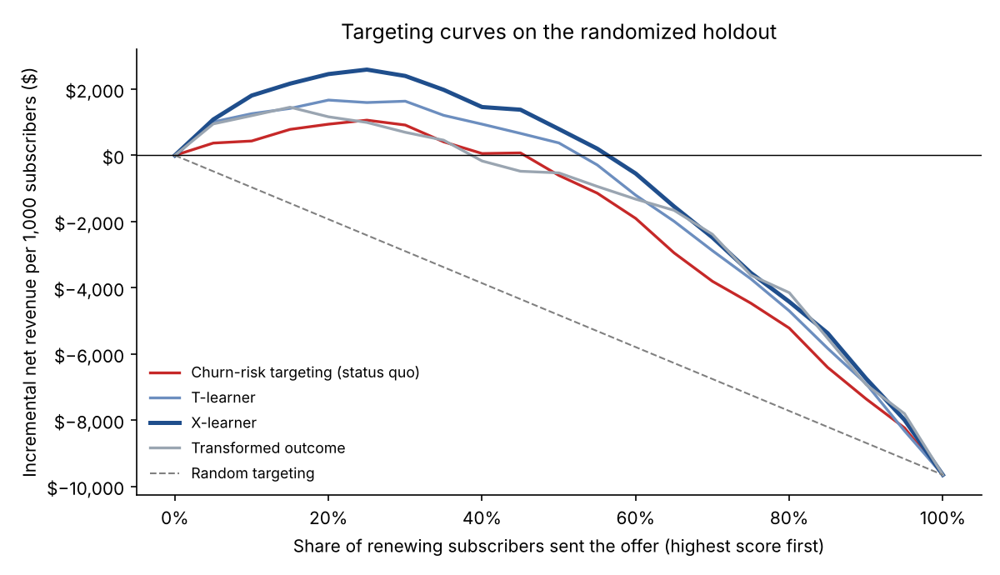
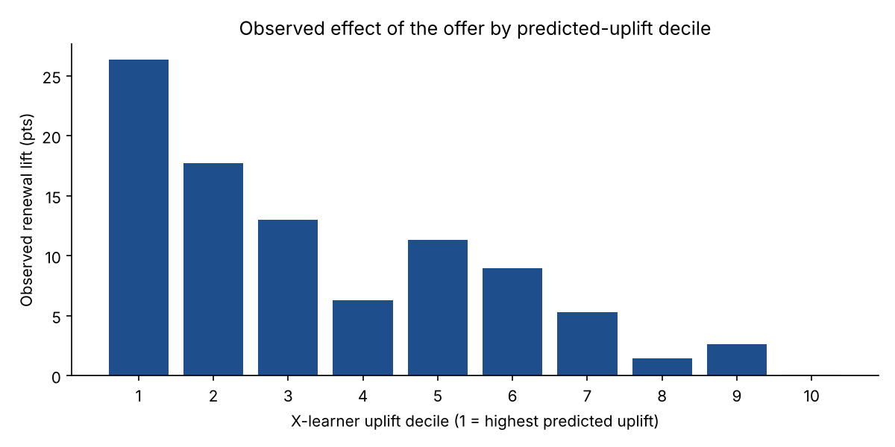

# Uplift Modeling: Who Should Actually Get the Retention Discount?

A subscription business tested a 20% renewal discount. It **raised renewals by 9 points**, and giving it to everyone would still have **lost about $9,700 per 1,000 subscribers**. Uplift modeling finds the subscribers the discount *changes*, rather than the ones who were going to renew anyway or were never going to.

  

> **Data note:** all data is synthetic, produced by [`data/generate_data.py`](data/generate_data.py): 60,000 subscribers up for annual renewal, randomly assigned 50/50 to a 20% discount offer or no offer. Each subscriber has a hidden individual treatment effect, saved separately and used **only to validate** the models at the end. It covers all four classic uplift groups, including "sleeping dogs" whom the offer makes *less* likely to renew.

---

## The business problem

Retention teams usually target the customers **most likely to churn**. That sounds right, but it answers the wrong question. A discount sent to:

| | Would renew without it | Would leave without it |
|---|---|---|
| **Offer changes nothing** | 💸 *Sure thing*: pure margin giveaway | 🚪 *Lost cause*: wasted offer |
| **Offer changes the outcome** | 🐕 *Sleeping dog*: the offer reminds them to cancel | ✅ ***Persuadable***: the only group worth paying for |

Churn models find lost causes and persuadables mixed together. **Uplift models estimate the *change* the offer causes** for each subscriber, net of the discount given to people who would have paid full price.

## Results at a glance

Evaluated on an 18,000-subscriber randomized holdout. "True value" uses the simulator's hidden ground truth, which exists only because the data is synthetic and isn't available in real life.

| Strategy | Who gets the offer | Est. net revenue / 1k subs | **True net revenue / 1k subs** | Correlation with true uplift |
|---|---|---|---|---|
| Offer to everyone | 100% | −$9,653 | — | — |
| Churn-risk targeting (status quo) | top 25% by churn risk | +$1,063 | **+$312** | — |
| Transformed outcome | top 15% | +$1,455 | +$745 | 0.52 |
| T-learner | top 20% | +$1,670 | +$1,061 | 0.67 |
| **X-learner** | **top 25%** | **+$2,591** | **+$1,430** | **0.74** |

- **Offering the discount to everyone loses money.** Most renewers would have paid full price.
- **The X-learner policy is worth about 4.6× the churn-risk policy** in true value, from targeting the same share of subscribers.
- **The holdout estimates run high.** The best targeting fraction was picked on the same holdout it's scored on (a mild winner's curse), and small top-k groups are noisy. Ranking the models works fine; for the dollar forecast, I'd use a fresh test.



## Approach

### 1. The right target: incremental net revenue, not renewal
Every model scores subscribers by:

```
uplift_revenue(x) = price × [ 0.8 × P(renew | offer, x) − P(renew | no offer, x) ]
```

A subscriber with a 95% renewal probability either way has **negative** value: the offer just gives away 20% of their payment. Targeting on renewal lift alone would miss that.

### 2. Models
| Model | Idea |
|---|---|
| **Churn-risk targeting** | Status quo. A renewal model on control subscribers; offer to the lowest predicted renewal. |
| **T-learner** | Two gradient-boosting renewal models, one per arm. Uplift is the difference in expected revenue. |
| **X-learner** ([Künzel et al., 2019](https://www.pnas.org/doi/10.1073/pnas.1804597116)) | Imputes each subscriber's individual effect using the *other* arm's outcome model, then learns those effects directly. Strong when effects are small compared with baseline noise, as they usually are. |
| **Transformed outcome** | A single regression on `Z = Y(T − e) / e(1 − e)`, whose expected value is the uplift. Unbiased but noisy. |

### 3. Evaluating something you can never observe
No one is observed both with and without the offer, so there's no "accuracy". Instead, **targeting curves** rank subscribers by score and, within each top-k%, compare treated against control outcomes. Because assignment was randomized, that comparison is an unbiased estimate of what targeting those people would earn. The **Qini coefficient** summarizes the area between each curve and random targeting ([table](reports/tables/targeting_curves.csv)).

### 4. Does the ranking make sense?
Observed renewal lift by X-learner decile on the holdout:



| Decile | Renewal without offer | With offer | Lift | Had a price increase | On auto-renew |
|---|---|---|---|---|---|
| 1 (highest uplift) | 41% | 67% | **+26 pts** | 95% | 16% |
| 5 | 70% | 81% | +11 pts | 17% | 59% |
| 10 (lowest) | 81% | 81% | **0 pts** | 3% | 83% |

The model learned a story a retention manager would recognize:
- **Persuadables** are mostly subscribers facing a **price increase**. The discount offsets it.
- **Sure things** are on **auto-renew**. Offering them a discount just gives away margin.
- **Sleeping dogs** (8% of subscribers in the simulation) are auto-renewers who rarely use the product. The offer email reminds them they're paying, and they cancel. They sink to the bottom of the ranking.

## Repository structure

```
├── data/generate_data.py          # randomized experiment simulator (+ validation-only ground truth)
├── src/uplift/
│   ├── models.py                  # churn-risk, T-learner, X-learner, transformed outcome
│   ├── evaluate.py                # targeting curves, Qini, true-value validation
│   └── pipeline.py                # train/holdout, comparison, decile profiles, figures
├── reports/                       # metrics.json, figures/, tables/
├── tests/                         # randomization, revenue, curve and learner tests
└── Makefile
```

## Run it yourself

```bash
git clone https://github.com/chatnic/pricing-uplift-modeling.git
cd pricing-uplift-modeling
python -m venv .venv && source .venv/bin/activate
make setup
make all      # simulate experiment -> fit models -> evaluate -> tests (~10 seconds)
```

## What I'd do next in a real engagement

- **Validate with a policy test.** Randomize subscribers into "model-targeted" vs. "business-as-usual targeting" and measure the real difference.
- **Optimize the offer, not just the audience.** Test 10%, 20% and 30% discounts and let the model choose the offer per subscriber (multi-treatment uplift).
- **Report uncertainty.** Bootstrap the targeting curves so the dollar forecast comes with a range.
- **Budget-constrained targeting.** If the retention team can only contact N people, take the top N by expected incremental profit.

## License

MIT. See [LICENSE](LICENSE).
